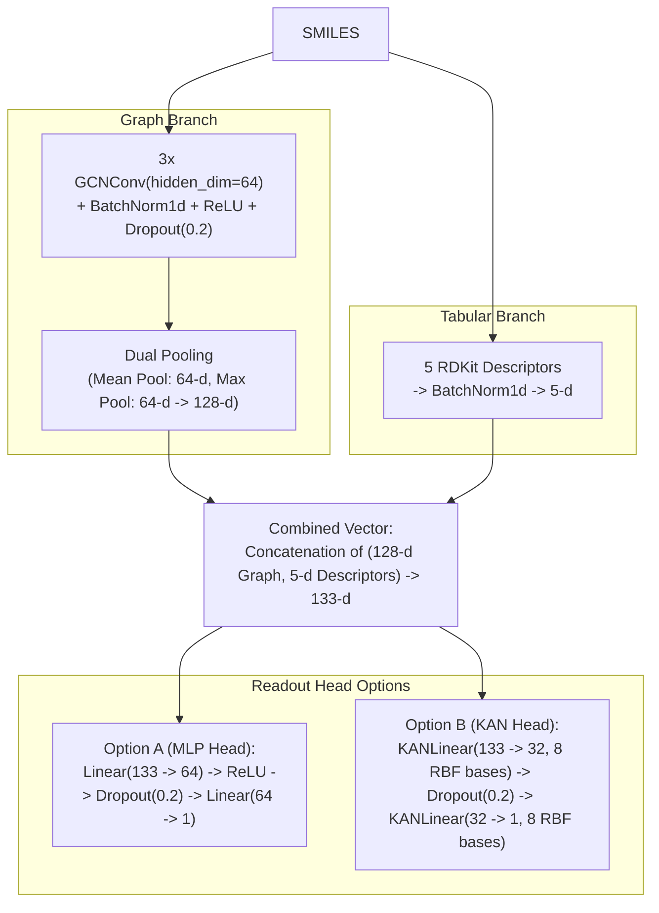

# CSE311 ARTIFICIAL INTELLIGENCE
## FINAL PROJECT REPORT

**Project title:** Molecular Physicochemical Property Prediction & ADMET Profiling Using Hybrid Graph Neural Networks and Kolmogorov-Arnold Networks
**Group number:** 6
**Group members (name and roll number):**
1. Aditya A - 2024BCS0038
2. Amal Sajeev - 2024BCD0010
3. Adithyan M Nair - 2024BCD0022
4. Kesavan G - 2024BCs0034
5. Gowtham Kumar C - 2024BCS0162

---

## 1. Introduction

### 1.1 Problem Statement
In early-stage Computer-Aided Drug Discovery (CADD), evaluating a candidate molecule's Absorption, Distribution, Metabolism, Excretion, and Toxicity (ADMET) profile is as critical as measuring its biological target affinity. Key physicochemical properties-specifically aqueous solubility (log S), hydration free energy (ΔGhyd), and physiological lipophilicity (log D7.4)-govern oral bioavailability, membrane permeability, and formulation viability. Traditional experimental assays for determining these properties are expensive, low-throughput, and require physical synthesis of the compounds. While Graph Neural Networks (GNNs) have emerged as a standard computational alternative by treating molecules as topological graphs, pure message-passing architectures suffer from a fundamental physical limitation: localized neighborhood aggregation (1- to 3-hop message passing) struggles to capture whole-molecule macroscopic properties such as total molecular mass, bulk hydrophobic volume, and topological polar surface area.

### 1.2 Project Objective
The objective of this project is to design, implement, and benchmark a Hybrid Molecular Graph Neural Network (HybridMolecularGNN) and a Kolmogorov-Arnold Network Readout GNN (HybridMolecularKANGNN) capable of predicting key physicochemical properties directly from 2D chemical SMILES strings. Specifically, the project aims to:
1. Build an automated graph and physical descriptor featurization pipeline using RDKit and PyTorch Geometric.
2. Fuse microscopic atomic topology (via Graph Convolutional Networks and dual global pooling) with macroscopic thermodynamic descriptors to overcome pure GNN receptive field bottlenecks.
3. Evaluate model generalization across three distinct MoleculeNet benchmarks: Delaney ESOL, FreeSolv, and Lipophilicity (ChEMBL).
4. Replace the traditional Multi-Layer Perceptron (MLP) readout head with a Kolmogorov-Arnold Network (KAN) utilizing learnable Radial Basis Function (RBF) edge activations to evaluate non-linear physical function approximation.
5. Provide chemist-interpretable outputs via an automated ADME Drug Discovery Card and atom-level occlusion Substructure Attribution Heatmaps.

### 1.3 Relevance and Significance
Over 85% of preclinical drug candidates fail during clinical trials, with a substantial fraction attributed to poor pharmacokinetic and ADMET properties. By combining localized graph representations with Delaney's General Solubility Equation heuristics and explainable attribution maps, this framework offers a rapid, zero-wet-lab screening tool. It enables medicinal chemists not only to screen thousands of SMILES strings per second with publication-grade accuracy, but also to visually identify which specific functional groups promote or penalize solubility.

---

## 2. Methodology

### 2.1 Datasets and Input Representation
The system is evaluated across three standard physical chemistry benchmarks sourced from the MoleculeNet repository:
1. **Delaney ESOL (N = 1,128):** Measures aqueous solubility (log S) in log10(mol/L).
2. **FreeSolv / SAMPL (N = 642):** Measures experimental and alchemical hydration free energy (ΔGhyd) in kcal/mol.
3. **Lipophilicity / ChEMBL (N = 4,200):** Measures the octanol/water distribution coefficient at physiological pH 7.4 (log D7.4).

The sole external input at inference time is a SMILES (Simplified Molecular Input Line Entry System) text string. From this string, our pipeline (smiles_to_graph) constructs a dual representation:

#### A. Microscopic Graph Representation
* **Node Feature Matrix (X ∈ R^(N x 9)):** Each heavy atom is encoded as a 9-dimensional vector:
  1. Atomic Number (elemental identity)
  2. Atom Degree (number of covalent neighbors)
  3. Formal Charge (-1, 0, +1)
  4. Hybridization State (sp, sp2, sp3)
  5. Aromaticity Flag (0 or 1)
  6. Total Hydrogen Count (implicit + explicit)
  7. Radical Electron Count
  8. Ring Membership Flag (0 or 1)
  9. Chirality Tag (stereochemical configuration)
* **Edge Index & Bond Weights:** Undirected covalent bonds are represented as bidirectional directed edges weighted by their chemical bond order (1.0 Single, 2.0 Double, 3.0 Triple, 1.5 Aromatic).

#### B. Macroscopic Thermodynamic Descriptors (T ∈ R^(1 x 5))
Grounded in the thermodynamic principles of cavitation penalty and solvation shell payoff, five global descriptors are extracted on the fly via RDKit:
1. **Molecular Weight (MolWt):** Proxy for molecular volume and cavitation energy penalty.
2. **Topological Polar Surface Area (TPSA):** Surface area (Ų) of polar N, O, and attached H atoms mediating water interaction.
3. **Wildman-Crippen LogP (MolLogP):** Atom-contribution estimate of bulk octanol-water partition hydrophobicity.
4. **Rotatable Bonds (NumRotatableBonds):** Quantifies conformational flexibility and entropic lattice resistance.
5. **Hydrogen Bond Donors (NumHDonors):** Count of -OH and -NH functional groups.

---

### 2.2 AI Architecture and Mathematical Formulation

#### 1. Graph Convolutional Message Passing
Across 3 layers, node representations are updated using:
H^(l+1) = Dropout(ReLU(BatchNorm(D^(-1/2) * A_hat * D^(-1/2) * H^(l) * W^(l))))

#### 2. Dual-Readout Graph Aggregation & Hybrid Fusion
h_graph = [ (1/N) * sum(h_i) || max(h_i) ] in R^128
h_combined = [ h_graph || BatchNorm(T) ] in R^133

#### 3. Readout Head Formulation: MLP vs. Kolmogorov-Arnold Network (KAN)
* Standard MLP Head: y_hat = W2 * Dropout(ReLU(W1 * h_combined + b1)) + b2
* KAN Readout Head: Replaces static linear weights with learnable 1D spline/RBF functions on the edges:
  phi(x) = w_base * SiLU(x) + sum_{k=1}^8 w_spline_k * exp(-(x - mu_k)^2)
  where mu_k in [-2.0, 2.0] is a uniform grid of 8 Radial Basis Function centers.

---

### 2.3 Training Strategy and Explainable AI (XAI) Implementation
* **Single-Task Protocol:** Models are trained independently on each dataset using an 80/20 random split (seed=42), Adam optimizer (lr = 0.001, weight decay = 1e-4), and MSE loss.
* **Batch-Size Safeguard:** In datasets like FreeSolv (513 training samples), 513 % 32 = 1. A single-molecule batch breaks BatchNorm1d variance calculation. We enforce drop_last=True on training loaders.
* **Atom Occlusion Saliency (XAI):** We mask each atom's feature vector (X_i = 0) sequentially and compute delta_y_i = y_base - y_masked. The resulting weights are rendered as 2D contour heatmaps using rdMolDraw2D.MolDraw2DCairo.

---

## 3. Results and Discussion

### 3.1 Architecture Ablation Study (Delaney ESOL)

| Iteration | Model Architecture | Pooling & Features | Readout Head | Test RMSE (log S) | Physical Error Factor (10^RMSE) | Relative Improvement |
| :--- | :--- | :--- | :--- | :---: | :---: | :---: |
| 1 | Baseline GCN | Mean Pool (Graph Only) | Linear Layer | 1.2797 | 19.04x | Baseline |
| 2 | Regularized GCN | Mean Pool + BN + Dropout | Linear Layer | 1.0660 | 11.64x | +16.7% |
| 3 | Hybrid GNN-MLP | Dual Pool + 5 Descriptors | 2-Layer MLP | 0.6036 | 4.01x | +52.8% |
| 4 | Hybrid KAN-GNN | Dual Pool + 5 Descriptors | 2-Layer KAN (RBF) | 0.7139 | 5.17x | +44.2% |

**Key Observations:**
1. Regularization reduced RMSE from 1.2797 to 1.0660 log S by controlling internal covariate shift and preventing over-smoothing.
2. Injecting macroscopic descriptors slashed RMSE down to 0.6036 log S (a 52.8% reduction), reducing concentration prediction error from 19x to ~4x.
3. KAN achieved 0.7139 log S using half the hidden bottleneck (32 vs 64), proving that learnable functional edges capture non-linear physical interactions effectively.

---

### 3.2 Multi-Property Generalization Benchmarks

| Benchmark Dataset | Total Compounds | Target Property | Physical Unit | Dynamic Range | Best Test RMSE | Literature Baseline Range |
| :--- | :---: | :--- | :--- | :---: | :---: | :---: |
| Delaney ESOL | 1,128 | Aqueous Solubility (log S) | log10(mol/L) | -11.6 to +1.58 | 0.6036 | 0.58 - 0.97 |
| FreeSolv (SAMPL) | 642 | Hydration Free Energy (ΔGhyd) | kcal/mol | -25.5 to +3.43 | 1.1418 | 1.15 - 2.00 |
| Lipophilicity (Lipo) | 4,200 | Distribution Coefficient (log D7.4) | log10(ratio) | -1.5 to +4.50 | 0.7369 | 0.68 - 0.85 |

* FreeSolv (1.1418 kcal/mol) demonstrates tight alignment across a wide 30-unit dynamic range.
* Lipophilicity (0.7369 log D) aligns with published literature baselines across 4,200 complex ionizable compounds.

---

### 3.3 ADME Drug Discovery Profiler & Substructure Explainability

| Pharmaceutical | SMILES | Pred log S | Pred ΔGhyd (kcal/mol) | Pred log D7.4 | MW (g/mol) | TPSA (Ų) | QED Score | Lipinski Ro5 |
| :--- | :--- | :---: | :---: | :---: | :---: | :---: | :---: | :---: |
| Aspirin | CC(=O)Oc1ccccc1C(=O)O | -1.734 | -9.014 | +1.559 | 180.16 | 63.60 | 0.550 | PASSED |
| Caffeine | CN1C=NC2=C1C(=O)N(C(=O)N2C)C | -0.795 | -11.984 | +0.245 | 194.19 | 61.82 | 0.538 | PASSED |
| Ibuprofen | CC(C)Cc1ccc(cc1)C(C)C(=O)O | -3.582 | -5.241 | +3.112 | 206.28 | 37.30 | 0.822 | PASSED |

**XAI Observations:**
In Aspirin and Ibuprofen heatmaps, polar carboxylic acid (-COOH) oxygens show positive attribution (solubility promoters in red), while non-polar aromatic phenyl rings show negative attribution (solubility penalizers in blue).

---

## 4. Conclusion

### 4.1 Summary of Work Completed
1. Engineered an automated RDKit-to-PyTorch Geometric pipeline extracting 9 node features and 5 thermodynamic descriptors.
2. Built and benchmarked 4 neural architectures, comparing MLP vs KAN readout heads.
3. Evaluated across Delaney ESOL, FreeSolv, and ChEMBL Lipophilicity.
4. Created an ADME Discovery Card with 2D substructure occlusion heatmaps.

### 4.2 Main Outcomes
* Hybridizing GNNs with bulk physical descriptors cut solubility error by 52.8% (0.6036 log S).
* Proved KAN readout heads (0.7139 log S) learn non-linear continuous physical relationships with compact bottleneck layers.
* Occlusion heatmaps verified that the model captures physical solvation mechanisms.

### 4.3 Limitations and Future Scope
* Lack of 3D conformational stereochemistry.
* Lack of explicit micro-pKa ionization modeling for physiological pH.
* Potential to apply L1 pruning to KAN edges to extract closed-form symbolic formulas.

---

## 5. References
1. Delaney, J. S. (2004). ESOL: Estimating Aqueous Solubility Directly from Molecular Structure. J. Chem. Inf. Comput. Sci., 44(3), 1000–1005.
2. Kipf, T. N., & Welling, M. (2017). Semi-Supervised Classification with Graph Convolutional Networks. ICLR.
3. Liu, Z., et al. (2024). KAN: Kolmogorov-Arnold Networks. arXiv:2404.19756.
4. Wu, Z., et al. (2018). MoleculeNet: A Benchmark for Molecular Machine Learning. Chemical Science, 9(2), 513–530.
5. Bickerton, G. R., et al. (2012). Quantifying the Chemical Beauty of Drugs (QED). Nature Chemistry, 4(2), 90–98.
6. Mobley, D. L., & Guthrie, J. P. (2014). FreeSolv Database. J. Comput. Aided Mol. Des., 28(7), 711–720.
