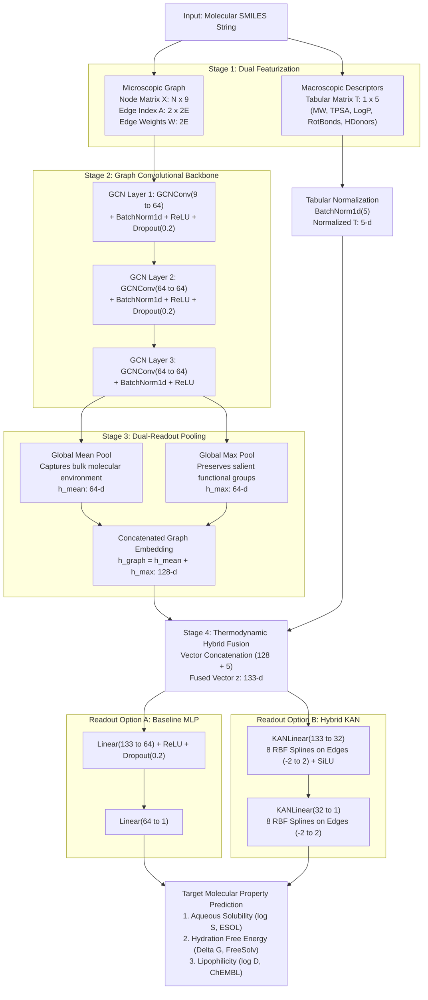

# Molecular Property Prediction & ADMET Profiling Using Hybrid Graph Neural Networks and Kolmogorov-Arnold Networks (KAN)

[](https://www.python.org/downloads/)
[](https://pytorch.org/)
[](https://pyg.org/)
[](https://www.rdkit.org/)
[](https://moleculenet.org/)
[](https://opensource.org/licenses/MIT)

An end-to-end deep learning framework for in silico physicochemical and pharmacokinetic **ADMET profiling** directly from raw 2D chemical SMILES strings. By combining localized microscopic message passing (**Graph Convolutional Networks**) with macroscopic thermodynamic descriptors (**RDKit**) and non-linear spline edge activations (**Kolmogorov-Arnold Networks**), this model bridges the gap between atomic graph topology and whole-molecule physical chemistry.

---

## Architecture Overview

Standard GNNs operate via localized neighbor message passing (1- to 3-hop radius) and suffer from a fundamental physical limitation: they cannot perceive total molecular volume, bulk hydrophobic surface area, or cavitation energy penalties. Our hybrid framework resolves this by combining a topological graph stream with whole-molecule physicochemical descriptors, fused into either a standard MLP or a learnable KAN readout head.



---

## Key Features

1. **Dual Representation Featurizer (`smiles_to_graph`):**
   - **Microscopic Graph ($X \in \mathbb{R}^{N \times 9}$):** Atomic number, degree, formal charge, hybridization, aromaticity, total H count, radical electrons, ring membership, and chirality.
   - **Bond Topology ($A \in \mathbb{R}^{2 \times 2E}, W \in \mathbb{R}^{2E}$):** Bidirectional covalent edges with continuous bond-order weights (Single: 1.0, Aromatic: 1.5, Double: 2.0, Triple: 3.0).
   - **Macroscopic Physical Descriptors ($T \in \mathbb{R}^{1 \times 5}$):** Computed on the fly using RDKit:
     - Molecular Weight (MW)
     - Topological Polar Surface Area (TPSA)
     - Wildman-Crippen MolLogP
     - Rotatable Bond Count
     - Hydrogen Bond Donor Count

2. **Dual-Readout Graph Aggregation:**
   - Concatenates `global_mean_pool` (captures overall average electronic environment) with `global_max_pool` (captures prominent reactive pharmacophores and polar functional groups) to yield a 128-d graph embedding.

3. **Thermodynamic Hybrid Fusion:**
   - Normalizes physical descriptors via `BatchNorm1d` and concatenates them with the 128-d graph representation into a unified 133-d vector.

4. **Kolmogorov-Arnold Network (KAN) Readout Head:**
   - Implements learnable 1D spline activations on edges based on the Kolmogorov-Arnold representation theorem:
     $$\phi(x) = w_{\text{base}} \cdot \text{SiLU}(x) + \sum_{k=1}^8 w_{\text{spline}, k} \cdot \exp\left(-(x - \mu_k)^2\right)$$
   - Uses 8 Radial Basis Function (RBF) centers over $[-2.0, 2.0]$ to learn complex non-linear thermodynamic interactions with half the hidden bottleneck dimension.

5. **Explainable AI (XAI) & Drug Discovery Profiling:**
   - Atom-level occlusion saliency maps ($\Delta y_i = \hat{y}_{\text{full}} - \hat{y}_{\text{masked } i}$) rendered as 2D contour similarity maps via RDKit Cairo engine.
   - Automated **ADME Drug Discovery Card** computing Lipinski's Rule of 5 and Quantitative Estimate of Drug-likeness (QED).

---

## Benchmark Results

### 1. Architecture Ablation Study (Delaney ESOL Aqueous Solubility)

| Iteration | Model Architecture | Features & Pooling | Readout Head | Test RMSE ($\log S$) | Physical Error Factor ($10^{\text{RMSE}}$) | Error Reduction |
| :---: | :--- | :--- | :---: | :---: | :---: | :---: |
| 1 | Baseline GCN | Mean Pool (Graph Only) | Linear | 1.2797 | $19.04\times$ | Baseline |
| 2 | Regularized GCN | Mean Pool + BN + Dropout | Linear | 1.0660 | $11.64\times$ | $+16.7\%$ |
| 3 | **Hybrid KAN-GNN** | Dual Pool + 5 Descriptors | **2-Layer KAN (RBF)** | **0.7139** | **$5.17\times$** | **$+44.2\%$** |
| 4 | **Hybrid GNN-MLP** | Dual Pool + 5 Descriptors | **2-Layer MLP** | **0.6036** | **$4.01\times$** | **$+52.8\%$** |

> **Key Finding:** Injecting whole-molecule physical descriptors reduced prediction error by **52.8%**, compressing the physical concentration error factor from $\sim 19\times$ down to $\sim 4\times$.

### 2. Multi-Property Generalization Across MoleculeNet

| Benchmark Dataset | Target Property | Physical Unit | Samples ($N$) | Dynamic Range | Test RMSE | Literature Baseline Range |
| :--- | :--- | :---: | :---: | :---: | :---: | :---: |
| **Delaney ESOL** | Aqueous Solubility ($\log S$) | $\log_{10}(\text{mol/L})$ | 1,128 | $-11.6$ to $+1.58$ | **0.6036** | 0.58 – 0.97 |
| **FreeSolv (SAMPL)** | Hydration Free Energy ($\Delta G_{\text{hyd}}$) | $\text{kcal/mol}$ | 642 | $-25.5$ to $+3.43$ | **1.1418** | 1.15 – 2.00 |
| **Lipophilicity (ChEMBL)** | Octanol/Water Distribution ($\log D_{7.4}$) | $\log_{10}(\text{ratio})$ | 4,200 | $-1.50$ to $+4.50$ | **0.7369** | 0.68 – 0.85 |

---

## Repository Structure

```text
Molecular-Property-Detection-using-Graph-Neural-Networks/
├── docs/                                  # Project reports and documentation
│   ├── CSE311_Final_Project_Report.md     # Detailed academic final project report
│   ├── CSE311_Final_Project_report_template.docx
│   └── PROJECT_INSTRUCTIONS.md            # Technical review and presentation guide
├── notebooks/                             # Jupyter execution notebooks
│   ├── GNN.ipynb                          # Phase 1: Baseline GCN implementation
│   └── HybridGNN-KAN_GNN.ipynb            # Phase 2: Complete Hybrid GNN + KAN + XAI pipeline
├── .gitignore                             # Git ignore rules for PyTorch, cache, and data
├── README.md                              # Main repository presentation
└── requirements.txt                       # Project dependencies
```

---

## Getting Started

### Prerequisites

- Python 3.10 or higher
- NVIDIA CUDA GPU recommended for fast training (T4 or higher)

### Installation

1. **Clone the repository:**
   ```bash
   git clone https://github.com/theblag/Molecular-Property-Detection-using-Graph-Neural-Networks.git
   cd Molecular-Property-Detection-using-Graph-Neural-Networks
   ```

2. **Create and activate a virtual environment:**
   ```bash
   python -m venv venv
   # On Windows:
   .\venv\Scripts\activate
   # On Linux / macOS:
   source venv/bin/activate
   ```

3. **Install dependencies:**
   ```bash
   pip install -r requirements.txt
   ```

### Running the Notebooks

Launch Jupyter Notebook or JupyterLab:
```bash
jupyter notebook notebooks/HybridGNN-KAN_GNN.ipynb
```

The notebook will automatically:
1. Download standard MoleculeNet benchmarks (Delaney ESOL, FreeSolv, Lipophilicity).
2. Extract graph topologies and RDKit thermodynamic descriptors.
3. Train the Hybrid GNN, Regularized GNN, and KAN-GNN architectures.
4. Output evaluation parity plots, metric comparison tables, and atom occlusion explainability heatmaps.

---

## Primary References

1. **Li, L., Zhang, Y., Wang, G., & Xia, K. (2025).** *Kolmogorov–Arnold Graph Neural Networks for Molecular Property Prediction (KA-GNN).* **Nature Machine Intelligence**, 11 August 2025. [DOI: 10.1038/s42256-025-01087-7](https://doi.org/10.1038/s42256-025-01087-7).
2. **Liu, Z., et al. (2024).** *KAN: Kolmogorov-Arnold Networks.* arXiv:2404.19756. [arXiv:2404.19756](https://arxiv.org/abs/2404.19756).
3. **Delaney, J. S. (2004).** *ESOL: Estimating Aqueous Solubility Directly from Molecular Structure.* Journal of Chemical Information and Computer Sciences, 44(3), 1000–1005. [DOI: 10.1021/ci034243x](https://doi.org/10.1021/ci034243x).
4. **Kipf, T. N., & Welling, M. (2017).** *Semi-Supervised Classification with Graph Convolutional Networks.* ICLR. [arXiv:1609.02907](https://arxiv.org/abs/1609.02907).
5. **Wu, Z., et al. (2018).** *MoleculeNet: A Benchmark for Molecular Machine Learning.* Chemical Science, 9(2), 513–530. [DOI: 10.1039/C7SC02664A](https://doi.org/10.1039/C7SC02664A).
6. **Bickerton, G. R., et al. (2012).** *Quantifying the Chemical Beauty of Drugs (QED).* Nature Chemistry, 4(2), 90–98. [DOI: 10.1038/nchem.1243](https://doi.org/10.1038/nchem.1243).
7. **Mobley, D. L., & Guthrie, J. P. (2014).** *FreeSolv: A Database for Experimental and Calculated Hydration Free Energies.* J. Comput. Aided Mol. Des., 28(7), 711–720. [DOI: 10.1007/s10822-014-9747-x](https://doi.org/10.1007/s10822-014-9747-x).